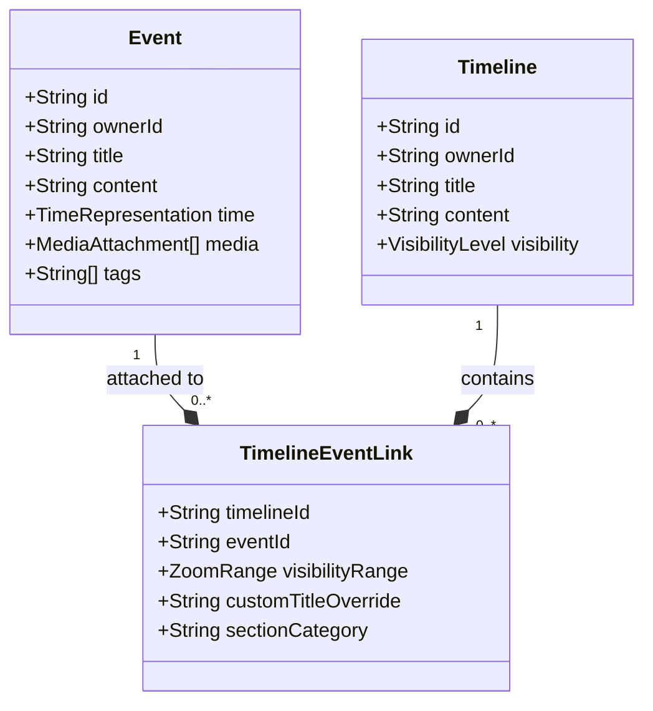

# Core Domain Concepts

This document defines the fundamental entities and concepts of the **Timelines** application. The system is designed around the decoupling of **Events** (the what and when) from **Timelines** (the how and where they are presented).

---

## 1. Events

An **Event** is a standalone, immutable historical or scientific fact. It represents something that happened at a specific point in time or over a specific duration.

### Attributes
- **ID**: A globally unique identifier.
- **Title**: A short, descriptive name (e.g., "First Moon Landing").
- **Content**: Detailed rich-text narrative.
- **Time/Duration**: The temporal coordinate (see [Time and Scale Model](02_time_and_scale.md)).
- **Media**: A collection of high-resolution images, videos, audio clips, or document attachments.
- **Tags/Metadata**: Labels used for categorization (e.g., `#spaceflight`, `#cold-war`, `#geology`).
- **Owner/Creator**: The user or organization that created the event.

### Independent Nature of Events
Events are **not** hardcoded inside a single timeline. Once an event is created:
- It exists in the user's global catalog.
- It can be linked to multiple timelines (e.g., a "History of Computing" timeline and a "Biography of Alan Turing" timeline can both link to the "Turing Machine Paper Published" event).
- If the event is public or shared, other users can reference it in their own timelines without duplicating the underlying data.

---

## 2. Timelines

A **Timeline** is a curated narrative, presentation, or layout of events. It defines the context in which events are compared and viewed.

### Attributes
- **ID**: A globally unique identifier.
- **Title**: The name of the timeline (e.g., "The Rise and Fall of the Roman Empire").
- **Content**: High-level explanation of the timeline's scope and purpose.
- **Visibility & Permissions**: Controls who can view, copy, or edit the timeline (Private, Shared, Org-Only, Public).
- **Owner**: The user or organization who manages this timeline.

---

## 3. The Timeline-Event Link (Level of Detail)

When an Event is attached to a Timeline, it does so through an association link. This link contains metadata specific to **how** that event behaves *on that specific timeline*.

### Zoom-Level Visibility (Level of Detail)
Because the timeline UI supports extreme zooming (from cosmic to atomic scales), displaying every event at once would clutter the screen.
- Each link defines a **Visibility Range** (Min Zoom Level to Max Zoom Level).
- **Example**: In a "History of the World" timeline:
  - The "World War II" event is visible at high levels of zoom (e.g., decades/centuries).
  - The "Battle of Stalingrad" event is only visible when zoomed in closely (e.g., months/days).
- In a detailed "World War II" timeline, however, both events might be visible at a high level of zoom.
- This decoupling allows the same event to adapt its prominence depending on the narrative scope of the timeline it belongs to.

### Custom Title/Content Overrides
To support educational and storytelling use cases, a timeline curator can override the event's display attributes *within the context of that timeline* without changing the original event.
- **Custom Title Override**: Shorten or tailor the title for the timeline's language or audience.
- **Section/Category**: Assign the event to a specific horizontal swimlane or group within the timeline.

---

## 4. Creative Expansions

To elevate the application beyond a simple static timeline tool, the following domain concepts are proposed:

### A. Event Causality & Threads (Relationship Layer)
Events are rarely isolated; they are connected by cause and effect. We introduce **Event Relationships**:
- **Causality Link**: Mark Event B as a direct consequence of Event A (e.g., "Assassination of Archduke Franz Ferdinand" $\rightarrow$ "Outbreak of WWI").
- **Visualization**: When viewing a timeline, the UI can draw subtle connecting lines or vectors between related events, allowing users to trace historical "chains of events."

### B. Nested Events (Micro-Timelines)
Some events are themselves entire timelines.
- **Concept**: An event can link to a sub-timeline.
- **Example**: The "Apollo Project" is a 9-year duration event. Clicking on it or zooming in reveals a nested timeline showing all the individual Apollo launches (Apollo 1, 8, 11, etc.).

### C. Event Templates (Schemas)
Different types of timelines require different types of details.
- **Biographical Events**: Include fields for Birth, Death, Location, and Parents/Children.
- **Scientific Experiments**: Include fields for Hypotheses, Data Outputs, Lab Equipment, and CERN/LHC run IDs.
- **Geological Eras**: Include Epoch definitions, dominant species, and global temperature estimates.
- *Templates dynamically render custom UI widgets in the Event detail drawer.*
