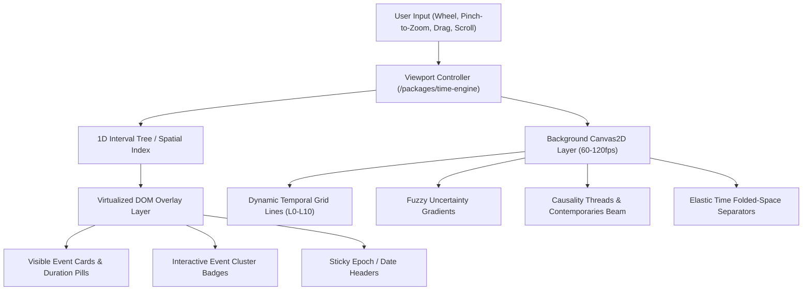

# Frontend Architecture, Design System & Monorepo Specification

This document defines the frontend technical stack (`/apps/web`), shared design system (`/packages/ui-components`), temporal math engine (`/packages/time-engine`), and monorepo tooling across the **Timelines** repository.

It pairs directly with [06_backend_architecture.md](file:///home/ncronquist/Documents/projects/timelines/spec/06_backend_architecture.md) to provide end-to-end TypeScript type safety from PostgreSQL and ElysiaJS to the browser canvas without introducing unnecessary operational complexity.

---

## 1. Core Frontend Stack (`/apps/web`)

### A. Build Tool, Framework & Rendering Model
- **Framework:** **React 19** + **TypeScript**
- **Build Tool & Dev Server:** **Vite** (running on **Bun**)
- **Rendering Strategy:** **Client-Side Single-Page Application (SPA)**
  - **Rationale:** Timelines is a highly interactive, 60–120fps spatial canvas application ([03_ui_ux_spec.md](file:///home/ncronquist/Documents/projects/timelines/spec/03_ui_ux_spec.md)) backed by mostly static historical and scientific data. A pure SPA architecture keeps runtime operations simple—requiring only a single backend server (`/apps/api`) and static frontend assets—avoiding dual-server SSR complexity and cookie-forwarding overhead.
  - **Link Previews & Open Data (No-SSR Workaround):** For public timeline sharing (OpenGraph social cards) and JSON-LD feeds ([05_future_considerations.md](file:///home/ncronquist/Documents/projects/timelines/spec/05_future_considerations.md)), lightweight metadata injection or dedicated API endpoints handle crawlers without requiring a full React SSR runtime.

### B. Routing & URL State
- **Router:** **TanStack Router** (`@tanstack/react-router`)
  - Provides 100% type-safe routing and first-class, schema-validated **URL Search Parameters**.
  - **URL as Source of Truth for Shareable Views:** Active timeline track IDs, current temporal viewport coordinates, zoom scale (`L0`–`L10`), active tag filters, and [Time-Travel Bookmarks](file:///home/ncronquist/Documents/projects/timelines/spec/03_ui_ux_spec.md) are serialized in the URL query string so any view can be bookmarked or shared via link.

### C. API Client, Caching & Auth Integration
- **End-to-End Type-Safe Client:** **Elysia Eden Treaty** (`@elysiajs/eden`)
  - Consumes the exported `App` type from `/apps/api` directly across the monorepo workspace, providing autocomplete and compile-time validation for all API routes, query parameters, and payloads with zero code generation.
- **Async Data & Cache Management:** **TanStack Query v5** (`@tanstack/react-query`)
  - Wraps Eden Treaty calls for declarative fetching, caching, and mutations.
  - **Aggressive Static Caching:** Because timeline data is predominantly static once published, queries default to generous `staleTime` and `gcTime` windows paired with HTTP caching headers (`ETag` / `Cache-Control`). Panning and zooming within already-fetched temporal ranges operate instantaneously out of memory.
  - **Future Live Timelines:** For future real-time or breaking-news timelines, Elysia WebSockets / Server-Sent Events (SSE) can push incremental event updates directly into the TanStack Query cache (`queryClient.setQueryData`).
- **Authentication Client:** **Better Auth React Client** (`better-auth/react`)
  - Connects directly to `/api/auth/*` on `/apps/api`, providing hooks (`useSession`, `useActiveOrganization`) for personal workspaces, classroom workflows, and organizational roles ([04_collaboration_and_orgs.md](file:///home/ncronquist/Documents/projects/timelines/spec/04_collaboration_and_orgs.md)).

### D. Client State Management
State is partitioned into three tiers based on update frequency:
1. **Server / Domain Cache (TanStack Query):** Timelines, events, versions, organizations, and user sessions.
2. **UI & Workspace State (Zustand):** Low-frequency application state such as sidebar visibility, active Detail Drawer event ID, Contemporaries Finder beam toggle, and local draft preferences.
3. **Transient 60fps Canvas Viewport State (Mutable Refs + `requestAnimationFrame`):**
   - During continuous trackpad pinch-zooming or kinetic vertical scrolling, the current `(epoch, coordinate, zoomScale)` viewport state updates inside a mutable controller in `/packages/time-engine` and notifies the canvas via `requestAnimationFrame`.
   - React state and URL search parameters are debounced/synced when gestures settle, preventing full React component tree re-renders on every animation frame.

---

## 2. Timeline Canvas Rendering Architecture

To satisfy the extreme scale requirements of [02_time_and_scale.md](file:///home/ncronquist/Documents/projects/timelines/spec/02_time_and_scale.md) ($10^{18}$ years to $10^{-18}$ seconds) and the rich visual interactions of [03_ui_ux_spec.md](file:///home/ncronquist/Documents/projects/timelines/spec/03_ui_ux_spec.md), the timeline viewport uses a **Hybrid Layered Rendering Architecture**:



### Layer 1: High-Frequency Background & Vector Layer (HTML5 `<canvas>` 2D)
- Redraws synchronously on every animation frame during zoom and scroll gestures.
- Renders:
  - Horizontal temporal grid lines and scale subdivisions (`L0` Cosmic through `L10` Nanosecond) with smooth opacity cross-fading between zoom thresholds.
  - Soft, fading gradient tails for events with high temporal uncertainty (`+/-` range / `Circa`).
  - [Elastic Time](file:///home/ncronquist/Documents/projects/timelines/spec/02_time_and_scale.md) folded-space visual separators.
  - [Event Causality](file:///home/ncronquist/Documents/projects/timelines/spec/01_core_concepts.md) Bezier connecting threads and the horizontal [Contemporaries Finder](file:///home/ncronquist/Documents/projects/timelines/spec/03_ui_ux_spec.md) highlight beam.

### Layer 2: Virtualized Interactive DOM Overlay
- Renders interactive event nodes, duration pill brackets, cluster badges, and sticky date headers as standard HTML/React elements positioned via GPU-accelerated transforms (`transform: translate3d(x, y, 0)`).
- **Spatial Indexing & Virtualization:** Backed by an in-memory **1D Interval Tree** in `/packages/time-engine`. Only events whose temporal coordinates or duration spans intersect the current `[minVisibleTime, maxVisibleTime]` viewport (plus an overscan buffer) are mounted in the DOM.
- **Why Hybrid:** Preserves crisp browser typography, standard CSS styling, keyboard accessibility, and screen-reader support for Event nodes while offloading high-density grid lines and continuous curves to `<canvas>`.

---

## 3. Design System & Styling (`/packages/ui-components` & `/apps/web`)

- **Styling Engine:** **Tailwind CSS v4** + **CSS Custom Properties (Design Tokens)**
  - Uses Tailwind v4's native Vite plugin and CSS-first `@theme` configuration.
  - **Dark-First & Dynamic HSL Track Theming:** Defaults to the dark-mode glassmorphic aesthetic defined in [03_ui_ux_spec.md](file:///home/ncronquist/Documents/projects/timelines/spec/03_ui_ux_spec.md). Each Timeline Track injects a scoped CSS custom property (`--track-hue`) so its event nodes, duration bars, and glow accents automatically derive harmonious HSL shades.
- **Component Primitives & Accessibility:** **shadcn/ui** built on **Radix UI Primitives**
  - Accessible, unstyled primitives owned directly inside `/packages/ui-components` (Slide-over Detail Drawer, Dialogs, Popovers, Tooltips, Dropdowns, Command Palette via `cmdk`).
  - Ensures full keyboard navigation (`Tab`, arrow keys, `Escape`) and WAI-ARIA compliance out of the box.
- **Animation & Transitions:**
  - **UI & Layout Transitions:** **Motion** (`motion`, formerly Framer Motion) for sliding drawers, modal transitions, cluster expand/collapse animations, and layout shifts.
  - **Canvas Physics:** Custom spring/damped interpolation inside `/packages/time-engine` for cursor-centered zoom and vertical scroll momentum.
- **Rich Text & Secondary Interactions:**
  - **Rich Text Editor:** **TipTap** for authoring and rendering rich-text Event narratives ([01_core_concepts.md](file:///home/ncronquist/Documents/projects/timelines/spec/01_core_concepts.md)).
  - **Drag and Drop:** **`@dnd-kit`** for reordering active timeline tracks in the Workspace Sidebar.
  - **Iconography:** **Lucide React** (`lucide-react`).

---

## 4. Shared Packages & Monorepo Architecture

### A. Workspace & Task Orchestration
- **Package Manager & Workspaces:** **Bun Workspaces** (single root `package.json` and `bun.lock`).
- **Task Runner & Build Caching:** **Turborepo** (`turbo.json`)
  - Orchestrates `dev`, `build`, `test`, `typecheck`, and `lint` pipelines across all apps and packages with local and CI task caching.
- **Internal Package Strategy (Just-in-Time TypeScript):**
  - Internal packages (`/packages/*`) export raw `.ts` and `.tsx` source files directly (`"main": "./src/index.ts"`).
  - Both Bun (`/apps/api`) and Vite (`/apps/web`) resolve and transpile workspace packages on the fly, eliminating the need for separate background build watchers during local development.

### B. Shared Package Responsibilities

1. **`/packages/time-engine` (Pure TypeScript, Zero DOM/Server Dependencies)**
   - Implements the **Composite Temporal Model** (`Time = (Epoch, Coordinate, Uncertainty)`) from [02_time_and_scale.md](file:///home/ncronquist/Documents/projects/timelines/spec/02_time_and_scale.md) using `BigInt`-backed coordinates so astronomical scales ($10^{18}$ years) and quantum scales ($10^{-18}$ seconds) never suffer IEEE-754 floating-point precision loss.
   - Provides deterministic conversion between temporal coordinates and screen-space pixel offsets (`timeToY`, `yToTime`) across zoom levels `L0`–`L10`.
   - Implements the **1D Interval Tree** for fast viewport culling, automatic **Event Clustering** math at zoomed-out scales, and **Elastic Time** empty-space detection/folding transforms.
   - Shared by both `/apps/api` (temporal validation, normalization, and database range indexing) and `/apps/web` (canvas projection).
2. **`/packages/types`**
   - Houses shared TypeBox schemas, domain enums (`VisibilityLevel`, `LifecycleStatus`, `ZoomLevel`), and shared API contract types bridging `/apps/api` and `/apps/web`.
3. **`/packages/ui-components`**
   - Houses the shared Tailwind v4 theme tokens, `shadcn/ui` + Radix primitives, and domain-agnostic UI components.
4. **`/packages/tsconfig`**
   - Shared base TypeScript configurations (`base.json`, `bun.json`, `react.json`) enforcing `strict: true` across the monorepo.

### C. Repository Directory Structure

```text
/timelines
├── /spec                        # Cross-project product & architecture specifications
│   ├── README.md
│   ├── 01_core_concepts.md
│   ├── 02_time_and_scale.md
│   ├── 03_ui_ux_spec.md
│   ├── 04_collaboration_and_orgs.md
│   ├── 05_future_considerations.md
│   ├── 06_backend_architecture.md
│   └── 07_frontend_and_monorepo.md
├── /apps
│   ├── /api                     # Bun + ElysiaJS + Drizzle + Better Auth backend
│   │   ├── /spec                # API-specific endpoint & schema specs
│   │   ├── /src
│   │   ├── Dockerfile
│   │   └── package.json
│   └── /web                     # React 19 + Vite + TanStack SPA frontend
│       ├── /spec                # Web-specific component & canvas specs
│       ├── /src
│       ├── Dockerfile
│       └── package.json
├── /packages
│   ├── /time-engine             # BigInt temporal math, L0-L10 scales, Interval Tree, Elastic Time
│   ├── /types                   # Shared TypeBox schemas, domain enums, & Eden Treaty types
│   ├── /ui-components           # Tailwind v4 design system, Radix/shadcn primitives
│   └── /tsconfig                # Shared strict TypeScript configurations
├── biome.json                   # Unified root linter & formatter configuration
├── docker-compose.yml           # Local PostgreSQL (+ optional MinIO / OTel profiles)
├── package.json                 # Bun workspace root & top-level scripts
└── turbo.json                   # Turborepo task pipeline configuration
```

---

## 5. Development Workflow, Code Quality & Packaging

- **Unified Linting & Formatting:** **Biome** (`@biomejs/biome`) configured via a single root `biome.json` checking both `/apps/*` and `/packages/*`.
- **Testing Strategy:**
  - **Unit & Domain Math Tests (`bun test`):** Fast, native unit tests for `/packages/time-engine` coordinate conversions, interval tree queries, and `/apps/api` service logic.
  - **Component & E2E Tests:** **Vitest** / **Playwright** for browser-based canvas interactions and critical user flows.
- **Root Developer Scripts (`package.json`):**
  - `bun dev`: Starts local PostgreSQL (if needed) and runs `/apps/api` (with `--watch`) and `/apps/web` (Vite HMR) in parallel via Turborepo.
  - `bun test`: Runs all unit and integration suites across workspaces.
  - `bun check`: Runs `biome check` and `turbo run typecheck` across the monorepo.
- **Frontend Production Packaging (`/apps/web/Dockerfile`):**
  - Multi-stage Docker build: Stage 1 uses `oven/bun` to install workspace dependencies and run `vite build` to produce static, content-hashed assets (`dist/`). Stage 2 serves the static bundle via a lightweight Nginx (or Bun static file server) container with SPA fallback routing (`try_files $uri /index.html`) and immutable cache headers for hashed assets.
